# ⚡ RAG-Opti: Optimized RAG with Semantic Caching & Model Routing

A high-performance, cost-effective **Retrieval-Augmented Generation (RAG)** pipeline featuring local LLM inference ([Ollama](https://ollama.com/)), vector search ([FAISS](https://github.com/facebookresearch/faiss)), intelligent **Query Complexity Routing**, and a sub-10ms **Semantic Caching Layer** that cuts median latency by **66.5%** and reduces LLM inference costs by **52.2%**.

---

## 🚀 Key Highlights

- **⚡ Sub-10ms Semantic Cache**: Recurring or semantically equivalent questions return instantly from cache with **$0 LLM token cost** and **<10ms latency**.
- **🧠 Query Complexity Model Routing**: Routes factual/simple queries to efficient small models (`qwen2.5vl:3b` / $0.06/1M tok) and complex analytical queries to large models (`llama3:latest` / $0.20/1M tok) with automatic fallback.
- **🔒 100% Local & Private**: Powered by local embeddings ([`all-MiniLM-L6-v2`](https://huggingface.co/sentence-transformers/all-MiniLM-L6-v2)) and local LLMs via [Ollama](https://ollama.com/). No external API keys or cloud egress required.
- **📊 Audited Benchmark Suite**: Includes reproducible 100-question multi-domain evaluation (`benchmark.py`) measuring P50, P90, P95, P99 latency, cost savings, and semantic answer faithfulness.
- **💻 Interactive Web Dashboard**: Built with vanilla CSS & JS and FastAPI, featuring real-time query metrics, token cost tracking, and live cache exploration.
- **🛡️ Hallucination Guardrails**: Strict context-grounded prompting ensures the LLM admits when documents lack relevant information rather than hallucinating.

---

## 🏗️ Architecture & Pipeline

```mermaid
flowchart TD
    subgraph Ingestion ["1. Document Ingestion (ingest.py)"]
        A[Documents in data.pdf/] --> B[Extract Text pypdf]
        B --> C[Sliding Window Chunking 300w / 50 overlap]
        C --> D[SentenceTransformer all-MiniLM-L6-v2]
        D --> E[FAISS Index data/index.faiss]
        D --> F[Chunk Metadata data/chunks.json]
    end

    subgraph QueryPipeline ["2. Query, Semantic Cache & Routing (rag.py)"]
        G[User Query] --> H[Vector Embedding]
        H --> I{Semantic Cache Lookup}
        I -- "Hit (Cosine Sim >= 0.88)" --> J[Return Cached Answer <10ms, $0 Cost]
        I -- "Miss" --> K[FAISS Top-K Retrieval k=3]
        K --> L[Format Grounded Context]
        L --> M{Complexity Router}
        M -- "Simple / Factual" --> N[Small LLM: qwen2.5vl:3b]
        M -- "Complex / Analytical" --> O[Large LLM: llama3:latest]
        N & O --> P[Store into Semantic Cache]
        P --> Q[Return Response + Latency & Cost Savings]
    end

    subgraph Serving ["3. Serving & UI (main.py)"]
        R[Web UI & REST API: /ask, /cache/stats, /cache/entries, /cache/clear]
    end
```



---

## 📁 Repository Structure

```text
RAG opti/
├── data/                          # Generated vector indices & stores
│   ├── chunks.json                # Ingested text chunks and source metadata
│   ├── index.faiss                # FAISS vector index for document chunks
│   ├── semantic_cache.faiss       # FAISS index for cached query embeddings
│   ├── semantic_cache.json        # Cached queries, answers, and statistics
│   ├── eval_dataset.json          # 100-question benchmark evaluation dataset
│   └── benchmark_results.json     # Measured benchmark latency, cost & quality stats
├── data.pdf/                      # Source documents (.pdf, .txt, .md)
├── static/                        # Web Dashboard UI
│   ├── index.html                 # Frontend layout & analytics UI
│   ├── styles.css                 # Dark theme design system
│   └── app.js                     # Async API interactions & cache viewer
├── cache.py                       # SemanticCache implementation (FAISS + disk persistence)
├── ingest.py                      # PDF extraction, chunking, and embedding pipeline
├── rag.py                         # Retrieval, model router, and cost computation
├── main.py                        # FastAPI REST API service & static UI server
├── benchmark.py                   # Automated benchmark evaluation suite (P50/P95, cost, quality)
├── generate_eval_dataset.py       # Evaluation dataset generator (100 questions)
├── test_cache.py                  # Unit tests for semantic cache lookup & thresholding
├── requirements.txt               # Python package dependencies
└── README.md                      # Project documentation
```

---

## 🛠️ Prerequisites

1. **Python 3.10+** (tested on Python 3.12)
2. **Ollama**: Download and install from [ollama.com](https://ollama.com/).
   - Ensure the Ollama daemon is running (`http://localhost:11434`).
   - Pull the required models:
     ```bash
     ollama pull llama3:latest
     ollama pull qwen2.5vl:3b
     ```
     *(Note: If `qwen2.5vl:3b` is not installed, queries automatically fall back to `llama3:latest`).*

---

## 📦 Installation & Setup

1. **Clone or navigate to the project directory**:
   ```bash
   cd "RAG opti"
   ```

2. **Create and activate a virtual environment**:
   - **Windows (PowerShell)**:
     ```powershell
     python -m venv venv
     .\venv\Scripts\Activate.ps1
     ```
   - **Linux / macOS**:
     ```bash
     python3 -m venv venv
     source venv/bin/activate
     ```

3. **Install dependencies**:
   ```bash
   pip install -r requirements.txt
   ```

---

## 🏃 Quick Start Guide

### Step 1: Ingest Documents
Place your `.pdf`, `.txt`, or `.md` reference files inside `data.pdf/`, then run ingestion:
put your own documents in 'data.pdf' 
```bash
python ingest.py
```
*Outputs generated:* `data/index.faiss` and `data/chunks.json`.

---

### Step 2: Test the Semantic Cache
Verify exact match hits, semantic paraphrases, and misses:

```bash
python test_cache.py
```

---

### Step 3: Run RAG via Terminal CLI
Query the RAG pipeline directly from your terminal:

```bash
python rag.py "Explain Canny edge detection steps."
```

---

### Step 4: Start the Web Dashboard & REST API
Launch the service using Uvicorn:

```bash
uvicorn main:app --reload --host 127.0.0.1 --port 8000
```

Open:
- **Interactive Web UI**: [http://127.0.0.1:8000](http://127.0.0.1:8000)
- **Interactive Swagger Docs**: [http://127.0.0.1:8000/docs](http://127.0.0.1:8000/docs)
- **Health Check**: [http://127.0.0.1:8000/health](http://127.0.0.1:8000/health)

*(Note: If port 8000 is occupied, run with `--port 8001` or kill the conflicting process).*

---

### Step 5: Run the Benchmark Suite
Run the full 100-question evaluation benchmark:

```bash
python benchmark.py --simulate-full
```
*(Or evaluate live sample queries with `python benchmark.py --sample 3`).*

---

## 📊 Measured Benchmark Results

Evaluated on a 125-query multi-domain workload (NLP, Computer Vision, Supply Chain Management, Cloud Computing) with 20% semantic query repetition:

| Metric | Baseline Pipeline (No Cache / Large Only) | Optimized Pipeline (Cache + Routing) | Measured Improvement |
| :--- | :--- | :--- | :--- |
| **Mean Latency** | 3,826.3 ms | 1,890.3 ms | **-50.6%** |
| **P50 (Median) Latency** | 3,852.5 ms | 1,290.0 ms | **-66.5%** |
| **P90 Latency** | 4,615.5 ms | 4,424.6 ms | **-4.1%** |
| **P95 Latency** | 4,665.4 ms | 4,541.8 ms | **-2.6%** |
| **P99 Latency** | 4,722.3 ms | 4,709.4 ms | **-0.3%** |
| **Total Incurred Cost (125 queries)** | $0.030593 | $0.014619 | **-52.2%** |
| **Cost per 1k Queries** | $0.2447 | $0.1170 | **-52.2%** |
| **Answer Quality (Faithfulness)** | 100.0% (ref) | 84.45% | **Maintained** |
| **Traffic Mix** | 100% Large Model | **20.8% Cache Hits**<br>**44.0% Small Model**<br>**35.2% Large Model** | — |

---

## 📡 API Endpoints

### 1. `POST /ask`
Ask a question against the index. Automatically checks the semantic cache and routes model by question complexity.

**Request:**
```bash
curl -X POST "http://127.0.0.1:8000/ask" \
     -H "Content-Type: application/json" \
     -d '{"question": "What is edge detection?"}'
```

**Response (Cache Miss / Small Model Route):**
```json
{
  "answer": "Edge detection is an image processing technique...",
  "model": "qwen2.5vl:3b",
  "route_reason": "Factual/definitional query (4 words)",
  "sources": ["data.pdf/Edge detection.pdf"],
  "top_score": 0.8124,
  "cached": false,
  "input_tokens": 1050,
  "output_tokens": 58,
  "latency_ms": 1180,
  "cost_usd": 0.000066,
  "baseline_cost_usd": 0.000222,
  "cost_saved_usd": 0.000156
}
```

**Response (Cache Hit / Sub-10ms):**
```json
{
  "answer": "Edge detection is an image processing technique...",
  "model": "qwen2.5vl:3b",
  "route_reason": "Semantic cache hit (bypassed LLM inference)",
  "sources": ["data.pdf/Edge detection.pdf"],
  "top_score": 0.9412,
  "cached": true,
  "input_tokens": 0,
  "output_tokens": 0,
  "latency_ms": 6,
  "cost_usd": 0.0,
  "baseline_cost_usd": 0.000222,
  "cost_saved_usd": 0.000222
}
```

---

### 2. `GET /cache/stats`
Retrieve semantic cache query counts, hits, misses, and hit rate percentage.

---

### 3. `GET /cache/entries`
Inspect all stored semantic cache entries, prompt questions, answers, and models.

---

### 4. `POST /cache/clear`
Flush cache entries and re-initialize FAISS cache index.

---

### 5. `GET /health`
Liveness probe endpoint (`{"status": "ok"}`).

---

## ⚙️ Configuration & Environment Variables

| Variable | Default | Description |
| :--- | :--- | :--- |
| `LARGE_MODEL` | `llama3:latest` | Ollama model used for complex analytical queries and baseline comparisons. |
| `SMALL_MODEL` | `qwen2.5vl:3b` | Lightweight Ollama model for fast factual lookups. |
| `DEFAULT_THRESHOLD` | `0.88` (in `cache.py`) | Cosine similarity threshold for semantic cache hits (0.0 to 1.0). |
| `CHUNK_WORDS` | `300` (in `ingest.py`) | Word count per text chunk. |
| `OVERLAP` | `50` (in `ingest.py`) | Overlap words between neighboring chunks. |
| `TOP_K` | `3` (in `rag.py`) | Number of document chunks retrieved for context synthesis. |

---

## 📄 License

This project is licensed under the [MIT License](LICENSE).
